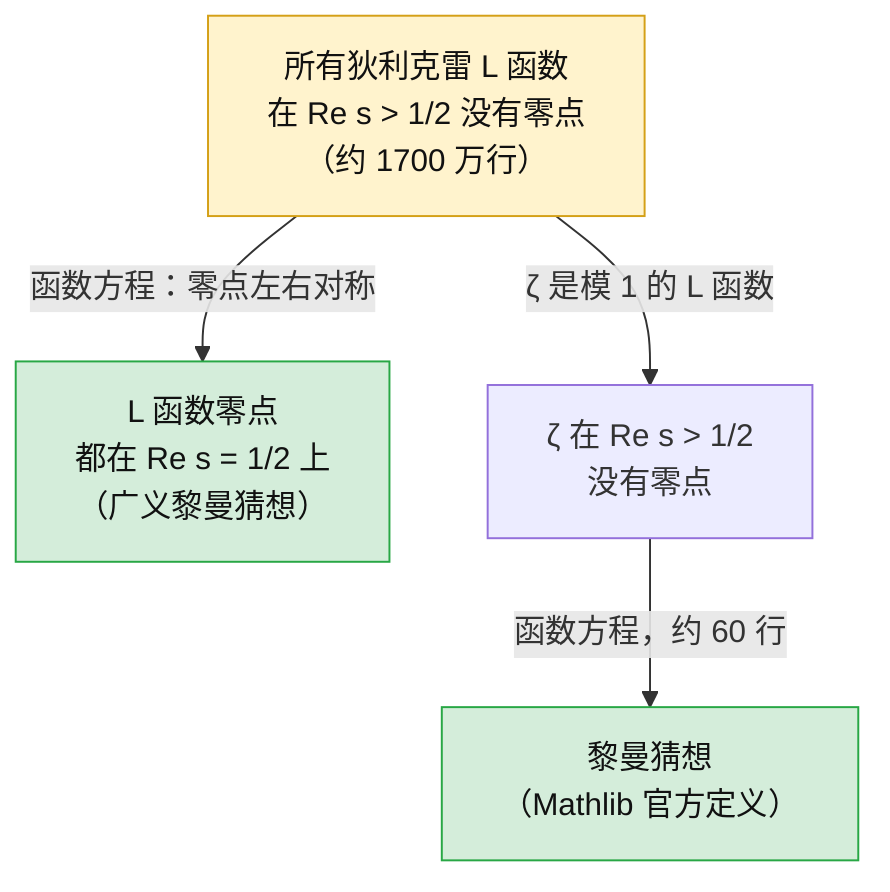

<div align="center">

# 黎曼猜想的 Lean 证明 · 中文导读版

**Levent Alpöge 与 Claude 合作给出的黎曼猜想（及广义黎曼猜想）Lean 4 形式化证明**
**原样收录全部源码，并附面向零基础读者的中文解读**

[30 秒速览](#30-秒速览) · [它证明了什么](#它到底证明了什么) · [现在可信吗](#现在可信吗) · [原始来源](#原始来源) · [阅读路线](#阅读路线)

</div>

> [!IMPORTANT]
> **证明的全部功劳属于数学家 [Levent Alpöge](https://alpo.ge/)（与 Claude 合作）。**
> 本仓库只是中文整理：`src/` 下的 Lean 代码与作者发布的原始压缩包**逐字节一致，没有任何改动**；
> README、`docs/` 中文文档、校验脚本是本仓库新增的。

> [!WARNING]
> **这是一个"声称的"证明。** 截至 2026-11-21，还没有公开的独立完整编译结果，也没有数学专家的审查结论。
> 作者本人的措辞也是"我相信"。请把它当作一件正在被检验的事来看待。

---

## 30 秒速览

| | |
|---|---|
| **谁** | Levent Alpöge，Anthropic 数学家，普林斯顿数学博士，哈佛学会青年学者 |
| **什么时候** | 2026 年 11 月 20 日，在个人网站发布 |
| **声称证明了什么** | **黎曼猜想**，以及更强的**狄利克雷 L 函数的广义黎曼猜想（GRH）** |
| **怎么做的** | 和 Claude 合作，前后约 6 周（2026-10-06 到 11-16）；终盘的大量技术推进来自 Claude |
| **证明长什么样** | 没有传统论文，只有 **Lean 4 代码**：175,187 个文件，约 1737 万行 |
| **为什么只有代码** | 机器生成的"人话版"超过 25 万页，作者认为发布它没有意义 |
| **核心想法一句话** | 把函数域上已有的"斯捷潘诺夫方法 + 重数"搬到整数上，用约 √X 层 theta 提升来"模拟"整数上不存在的求导 |
| **现在的状态** | 陈述已被确认是正确的命题，静态扫描无 `sorry`/`axiom`，**完整编译仍在进行中** |

---

## 目录

- [这件事是怎么回事](#这件事是怎么回事)
- [黎曼猜想，一分钟版](#黎曼猜想一分钟版)
- [它到底证明了什么](#它到底证明了什么)
- [证明是怎么想出来的](#证明是怎么想出来的)
- [现在可信吗](#现在可信吗)
- [仓库里有什么](#仓库里有什么)
- [快速上手](#快速上手)
- [原始来源](#原始来源)
- [阅读路线](#阅读路线)
- [常见问题](#常见问题)
- [版权与致谢](#版权与致谢)

---

## 这件事是怎么回事

1. **2026-11-20**，Levent Alpöge 在个人网站 alpo.ge 发布了一份 4 页的英文说明 [`remark.pdf`](https://alpo.ge/remark.pdf)，和 14 个 Lean 代码压缩分卷。
2. 他在说明中写道：他相信自己与 Claude 一起找到了黎曼猜想的证明；这个方法还能解决广义黎曼猜想，再给些时间应该也能做到扩展黎曼猜想；而且论证已经**不带任何假设地**完整写成了 Lean。
3. 他说，学生时代起他就把这个问题当作几十年的目标；这一次在终点线附近，**Claude 远远跑在了他前面**。
4. 因为自动生成的人类可读版本超过 25 万页、没法读，他决定**只公开 Lean 代码**，并打算之后去理解、简化、把它好好写出来。

完整的中文导读见 👉 [docs/02-作者说明导读.md](docs/02-作者说明导读.md)

---

## 黎曼猜想，一分钟版

- **质数**（2、3、5、7、11……）看起来没有规律，但数学家早就知道"不超过 x 的质数大约有 x / ln x 个"。
- 问题是：**这个估计的误差能有多小？**
- 1859 年，黎曼发现答案完全藏在一个函数里：**ζ(s) = 1 + 1/2ˢ + 1/3ˢ + …**。误差的大小，取决于这个函数的零点在哪里。
- **黎曼猜想**：ζ 函数所有"非平凡"零点的实部都等于 **1/2**，也就是全部排在复平面上的一条直线上。
- 它是克雷研究所 **100 万美元**的千禧年难题之一，也是希尔伯特第 8 问题。数学里有成百上千个定理以"假设黎曼猜想成立"为前提。
- **广义黎曼猜想**把同样的论断推广到一整族"狄利克雷 L 函数"，ζ 只是其中最简单的一个。所以它**更强**。

详细的零基础解释见 👉 [docs/01-黎曼猜想是什么.md](docs/01-黎曼猜想是什么.md)

---

## 它到底证明了什么

整个项目的"终点"是 [`src/Main.lean`](src/Main.lean)，只有 12 行：

```lean
theorem riemannHypothesis : RiemannHypothesis := rhOfAll                         -- 黎曼猜想
theorem riemannZeta_eq_zero_re : RiemannZetaZerosOnLine := rhOfAll               -- 黎曼猜想（等价写法）
theorem LFunction_ne_zero_of_half_lt_re : DirichletLNonvanishingRightOfHalf := allChi   -- L 函数在 Re s > 1/2 无零点
theorem LFunction_eq_zero_re : DirichletLZerosOnLine := claimAll.2.1             -- L 函数零点都在 Re s = 1/2
theorem LFunction_eq_zero_re_of_isPrimitive : PrimitiveDirichletLZerosOnLine := critAll  -- 广义黎曼猜想（本原特征）
```

<sub>上面的注释是本仓库为方便阅读加的，原文件里没有。</sub>

**关键在第一行**：`RiemannHypothesis` 不是作者自己定义的，而是 Lean 官方数学库 **Mathlib** 里早就写好的定义（[`RiemannZeta.lean` 第 185 行](https://github.com/leanprover-community/mathlib4/blob/0df444a360eaa60ab8c11dca51a86af692955474/Mathlib/NumberTheory/LSeries/RiemannZeta.lean#L185)）：

```lean
def RiemannHypothesis : Prop :=
  ∀ (s : ℂ) (_ : riemannZeta s = 0) (_ : ¬∃ n : ℕ, s = -2 * (n + 1)) (_ : s ≠ 1), s.re = 1 / 2
```

> 对任意复数 s：如果 ζ(s) = 0，且 s 不是 −2、−4、−6… 这些平凡零点，且 s ≠ 1，那么 s 的实部等于 1/2。

所以**没有偷换题目的空间**。另外四个命题定义在只有 16 行、只引用 Mathlib 的 [`src/Statements.lean`](src/Statements.lean) 里。

证明链条的最后几步其实很短：



逐行解读和证明链条的文件位置见 👉 [docs/03-Lean陈述逐行解读.md](docs/03-Lean陈述逐行解读.md)

---

## 证明是怎么想出来的

> 这一节是对作者说明的通俗转述，不是数学上严格的描述。

**出发点：一个已经解决的"类比版本"。**
在"函数域"（用多项式代替整数的数学世界）里，黎曼猜想的类比版本早在 20 世纪中叶就被韦伊和德利涅证明了。
斯捷潘诺夫后来给出了一种初等证法，关键是构造一个**带"重数"的辅助对象**。重数就是"零点重复了几次"，而制造重数要靠**求导**。

**难点：整数没法求导。**
把这个方法搬到真正的整数和质数上，就卡在这里：整数世界里没有对应的"导数"。

**突破：用一串 theta 提升来模拟重数。**
作者在一个玩具模型里发现了一些新的傅里叶分析想法，并把问题引导到对应的正确情形。随后 Claude 推进了大量技术细节，最关键的一步是：
把很多次 **theta 提升**（一种在不同对称群之间"搬运"自守形式的构造）串成一条链，每一层提升"模仿"一层重数。
那么链条该多长？对于长度为 X 的质数加权和，Claude 给出的答案是 **√X**。

**代价：用到了数论的半壁江山。**
时间线里出现了岩泽塔、拉利斯跷跷板、博斯特斜率不等式、GGP 周期、相对迹公式、西格尔质量公式、一个弱化版的范迪维尔猜想……
作者坦言需要的数学"比学生时代想象的多得多"，并且预计证明会被**大幅简化，而且可能很快**。

20 条时间线的分组解读和名词表见 👉 [docs/02-作者说明导读.md](docs/02-作者说明导读.md#5-时间线第-34-页概括)

---

## 现在可信吗

**一份 Lean 证明可信，需要同时满足两件事：**

1. **陈述正确**：代码证明的真的是黎曼猜想。这要人来看，但只需要看 28 行。
2. **证明能编译，且只用标准公理**：这交给计算机，但需要大型服务器跑很长时间。

| 检查项 | 状态（截至 2026-11-21） | 说明 |
|---|:---:|---|
| 来源一致 | ✅ | 本仓库、多个镜像、独立验证项目都核对了同一个 SHA-256 |
| 陈述正确 | ✅ | 主定理类型就是 Mathlib 的 `RiemannHypothesis`，多位评论者确认形式化陈述是广义黎曼猜想 |
| 静态扫描 | ✅ | 175,187 个文件中没有 `sorry`、`axiom`、`native_decide` 等 |
| 完整编译 | ⏳ | [独立验证项目](https://github.com/luosiallen/riemann-hypothesis-lean-verify) 2026-11-20 在 128 核机器上启动，尚无完成结果 |
| 公理审计 | ⏳ | 等待编译完成后运行 `#print axioms` |
| 专家审查 | ⏳ | 没有人类可读的论文，短期内很难进行 |

> [!NOTE]
> 不要和 **2026 年 8 月** Anthropic 发布的另一项结果混淆：那次是 Claude 把"可证明在临界线上的零点比例"从 41.6% 提高到 67.2%，
> [Anthropic 当时明确表示那不是黎曼猜想的证明](https://anthropic.com/research/riemann-zeta)。11 月这次声称的是**全部**零点都在线上。

自己动手验证的完整步骤见 👉 [docs/04-如何自己验证.md](docs/04-如何自己验证.md)

---

## 仓库里有什么

```
riemann-hypothesis-lean-zh/
├── README.md                     ← 你正在读的文件
├── docs/                         ← 中文文档（本仓库新增）
│   ├── 01-黎曼猜想是什么.md        零基础解释
│   ├── 02-作者说明导读.md          remark.pdf 中文导读 + 名词解释
│   ├── 03-Lean陈述逐行解读.md      看懂 28 行就知道证明了什么
│   ├── 04-如何自己验证.md          编译、公理审计、进展
│   └── 05-来源与报道.md            一手来源、媒体报道、学界反应
├── original/README.md            ← 作者原始 PDF 和分卷的获取方式
├── scripts/fetch-original.sh     ← 从作者网站下载并校验原始文件
├── SHA256SUMS                    ← 原始文件哈希
├── Check.lean                    ← 公理检查（本仓库新增）
│
├── lakefile.toml                 ┐
├── lake-manifest.json            │ 以下全部来自作者原始压缩包，未改动
├── lean-toolchain                │
└── src/                          ┘ 175,187 个 .lean 文件，约 1737 万行
    ├── Main.lean                   最终定理（12 行）
    ├── Statements.lean             命题定义（16 行）
    ├── Development/                1223 万行
    ├── Formalism/                  320 万行
    ├── GroundTheory/               112 万行
    ├── ReciprocityTheory/          56 万行
    ├── CompanionTheory/            19 万行
    ├── PositivityTheory/  Lemmata/  Supplements/  BuildAid/
```

---

## 快速上手

**只想看代码**：直接在 GitHub 网页上打开 [`src/Main.lean`](src/Main.lean) 和 [`src/Statements.lean`](src/Statements.lean)。

**克隆仓库**（约 1.3 GB，建议浅克隆）：

```bash
git clone --depth 1 https://github.com/Reen-Ai-H/riemann-hypothesis-lean-zh.git
```

**下载作者原始 PDF 并校验**：

```bash
cd riemann-hypothesis-lean-zh && bash scripts/fetch-original.sh
```

**确认本仓库代码与作者原版逐字节一致**（会下载约 240 MB）：

```bash
bash scripts/fetch-original.sh --lean
```

**完整编译与公理检查**（需要大型服务器，详见 [04 篇](docs/04-如何自己验证.md)）：

```bash
lake exe cache get && lake build Main && lake env lean Check.lean
```

---

## 原始来源

### 作者本人发布（一手来源）

| 内容 | 地址 | 备份 |
|---|---|---|
| 📄 作者说明 `remark.pdf`（4 页，英文） | <https://alpo.ge/remark.pdf> | [互联网档案馆快照](https://web.archive.org/web/20261120141958/https://alpo.ge/remark.pdf) |
| 📦 Lean 源码 14 个分卷 | <https://alpo.ge/lean.tar.gz.part01> … `part14` | [part01 快照](https://web.archive.org/web/20261120142003/https://alpo.ge/lean.tar.gz.part01) |
| 👤 作者主页 | <https://alpo.ge/> | |

### 重要报道与讨论

| 来源 | 链接 |
|---|---|
| Scientific American（2026-11-20） | [Anthropic mathematician claims to prove Riemann hypothesis](https://www.scientificamerican.com/article/anthropic-mathematician-claims-to-prove-riemann-hypothesis-most-famous-problem-in-all-of-math/) |
| Hacker News 讨论（1298 分，858 条评论） | [news.ycombinator.com/item?id=50574968](https://news.ycombinator.com/item?id=50574968) |
| 数学家反应汇总（OfficeChai） | [How mathematicians have reacted](https://officechai.com/ai/how-mathematicians-have-reacted-to-claimed-riemann-hypothesis-proof-by-anthropics-levent-alpoge/) |
| Interesting Engineering | [Claude helped prove 167-year-old Riemann hypothesis, researcher claims](https://interestingengineering.com/ai-robotics/anthropic-167-year-old-riemann-hypothesis-claude) |
| 独立编译验证项目 | [luosiallen/riemann-hypothesis-lean-verify](https://github.com/luosiallen/riemann-hypothesis-lean-verify)（[实时看板](https://luosiallen.github.io/riemann-hypothesis-lean-verify/)） |
| 英文镜像 | [CocoSgt/riemann-hypothesis-lean](https://github.com/CocoSgt/riemann-hypothesis-lean) |
| 背景：Anthropic 2026-08 零点比例结果 | [anthropic.com/research/riemann-zeta](https://anthropic.com/research/riemann-zeta) |
| 背景：Mathlib 中的黎曼猜想定义 | [RiemannZeta.lean#L185](https://github.com/leanprover-community/mathlib4/blob/0df444a360eaa60ab8c11dca51a86af692955474/Mathlib/NumberTheory/LSeries/RiemannZeta.lean#L185) |
| 背景：克雷研究所千禧年难题 | [claymath.org/millennium/riemann-hypothesis](https://www.claymath.org/millennium/riemann-hypothesis/) |

更完整的列表（含学界人士观点、更多媒体）见 👉 [docs/05-来源与报道.md](docs/05-来源与报道.md)

---

## 阅读路线

| 你是 | 建议阅读顺序 | 用时 |
|---|---|---|
| 🙋 完全不懂数学，想知道发生了什么 | 本页 → [01](docs/01-黎曼猜想是什么.md) → [02 的前两节](docs/02-作者说明导读.md) | 15 分钟 |
| 🎓 学过高数，想知道证明了什么、可不可信 | 本页 → [03](docs/03-Lean陈述逐行解读.md) → [04](docs/04-如何自己验证.md) | 30 分钟 |
| 🔢 数学专业，想了解技术路线 | [02 第 5 节时间线](docs/02-作者说明导读.md#5-时间线第-34-页概括) → 作者[英文原文](https://alpo.ge/remark.pdf) → 从 `src/Supplements/Kernels/MainTheorems.lean` 往下读 | 不限 |
| 💻 想亲手编译验证 | [04](docs/04-如何自己验证.md) | 一台大服务器 + 很长时间 |

---

## 常见问题

<details>
<summary><b>Lean 证明通过了，是不是就 100% 正确？</b></summary>

几乎是，但有前提：(1) 陈述要写对，这一点已经可以人工确认；(2) 只依赖 Lean 的三条标准公理，要等编译后用 `#print axioms` 检查；(3) Lean 内核本身没有 bug，这个概率极低。满足这三点，可信度远高于传统的人工审稿。
</details>

<details>
<summary><b>1700 万行代码，人类永远读不完，这还算数学证明吗？</b></summary>

在逻辑上算：机器已经逐步检查过每一步。但数学界通常还希望证明能被**理解**，能带来新的思想和工具。作者自己也说，他打算去理解它、简化它，并写出人类能读的版本。他的直觉是证明会被大幅简化。
</details>

<details>
<summary><b>是 Claude 证明的，还是作者证明的？</b></summary>

按作者自己的说法，是合作：他为这个问题准备了很多年，定下了方向（把玩具模型里的两种想法结合起来），并把问题引导到正确的情形；之后 Claude 在终点线附近的技术推进远超他，其中有些部分他自己也还没完全掌握。学界对两者各占多少功劳有不同看法。
</details>

<details>
<summary><b>为什么作者在 Anthropic 工作，会有人质疑？</b></summary>

有人怀疑发布时机与公司利益有关。作者在说明里专门回应，说这种解读是错的，发布的决定由他个人负责。不过无论动机如何，Lean 证明的好处正在于此：**不需要相信任何人，只需要让机器检查**。
</details>

<details>
<summary><b>为什么不直接把 remark.pdf 和完整中文翻译放进仓库？</b></summary>

作者没有给 PDF 附任何许可协议，默认版权归作者。本仓库提供原始链接、存档备份、哈希校验和一键下载脚本，保证你拿到的是作者原版；同时用中文导读把内容讲清楚。如果作者明确同意转载或翻译，会补充进 `original/` 目录。详见 [original/README.md](original/README.md)。
</details>

<details>
<summary><b>这和网上其他"我证明了黎曼猜想"有什么不同？</b></summary>

三点：(1) 作者是有扎实发表记录的职业数论学家；(2) 证明以 Lean 形式化发布，主定理直接使用 Mathlib 官方定义，任何人都能机器检查；(3) 静态扫描没有发现 `sorry` 或自定义公理。但在完整编译和公理审计完成之前，它仍然只是"声称"。
</details>

---

## 版权与致谢

- **数学内容和 Lean 代码**的作者是 **Levent Alpöge**（与 Claude 合作），原始发布地址 <https://alpo.ge/>。作者发布时**没有声明许可协议**，本仓库不对这些内容附加任何许可，也不主张任何作者身份。
- **中文文档**（`README.md`、`docs/`、`original/README.md`）、`scripts/`、`Check.lean`、`SHA256SUMS` 为本仓库整理新增。
- 作者说明的版权归作者所有，本仓库仅提供链接与中文导读，不转载全文。
- 构建说明参考了 [CocoSgt/riemann-hypothesis-lean](https://github.com/CocoSgt/riemann-hypothesis-lean) 和 [luosiallen/riemann-hypothesis-lean-verify](https://github.com/luosiallen/riemann-hypothesis-lean-verify) 的公开记录。
- 如果作者希望修改或删除本仓库的任何内容，会立即照办。

发现错误或有新进展？欢迎提 [Issue](https://github.com/Reen-Ai-H/riemann-hypothesis-lean-zh/issues)。
