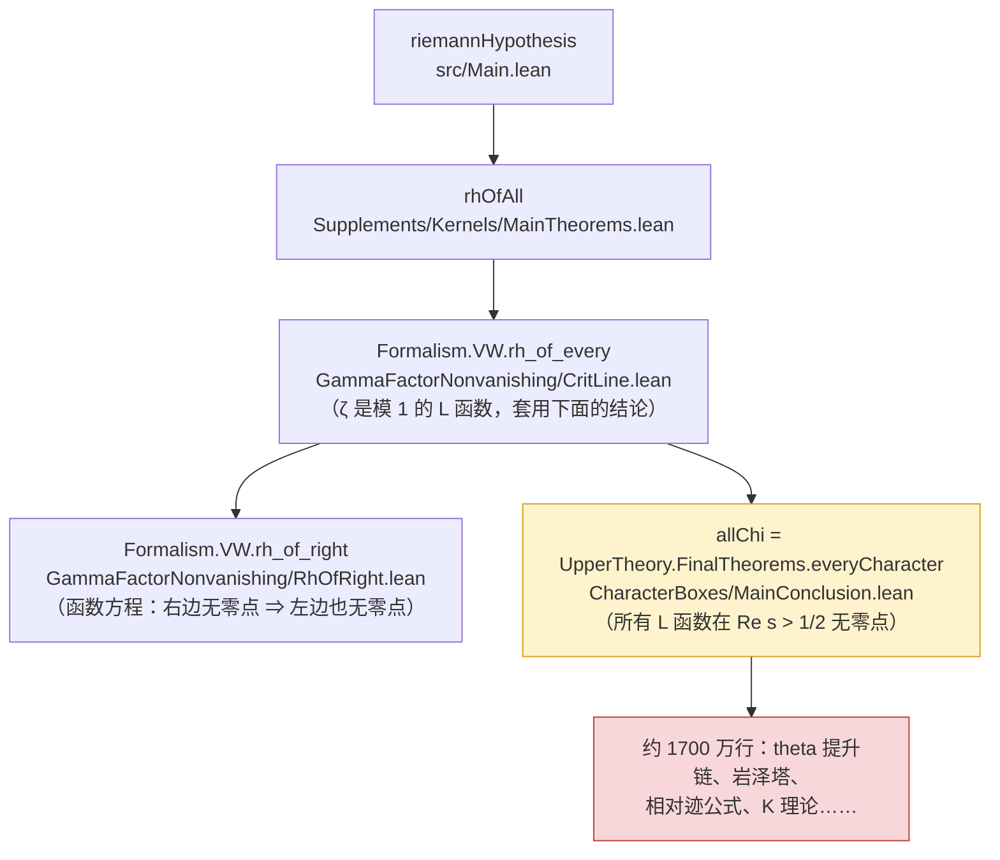

# 03 · Lean 陈述逐行解读

> 1700 多万行代码，外行不需要也不可能全看。**只要看懂两个文件（共 28 行），就知道这份代码声称证明了什么。**
> 剩下的问题交给计算机：代码能不能编译通过。

## 先说清楚：Lean 是什么，它能保证什么

**Lean** 是一种"证明助手"编程语言。你把数学定义和证明写成代码，Lean 的**内核**（一个很小、被反复审查过的程序）会逐步检查每一步推理是否合法。只要编译通过、且没有偷偷加入额外公理，就说明"从这些定义出发，这个定理确实成立"。

**Mathlib** 是 Lean 社区维护的数学库，已有几百万行，包含复数、ζ 函数、狄利克雷特征等定义。本项目建立在 Mathlib 的固定版本上（commit `0df444a3…`）。

Lean 能保证的和不能保证的：

| ✅ 能保证 | ❌ 不能保证 |
|---|---|
| 编译通过的定理，在 Lean 的逻辑里确实由它的证明推出 | 定理的**陈述**真的就是我们想要的那个数学命题（这要人来看） |
| 用 `#print axioms` 可以列出它依赖的全部公理 | Lean 内核或编译器本身没有 bug（概率极低，但不是零） |
| 不需要相信作者或 Claude 的任何文字说明 | 证明是否"好懂"、能否被人类理解和简化 |

所以，验证这份证明就分成两步：**(1) 人工确认陈述正确**（就是本篇要做的事），**(2) 机器确认证明能编译、只用标准公理**（见 [04 篇](04-如何自己验证.md)）。

---

## 文件一：`src/Main.lean`（12 行）—— 最终的五个定理

```lean
import Statements
import Supplements.Kernels.MainTheoremsAll

theorem riemannHypothesis : RiemannHypothesis := rhOfAll

theorem riemannZeta_eq_zero_re : RiemannZetaZerosOnLine := rhOfAll

theorem LFunction_ne_zero_of_half_lt_re : DirichletLNonvanishingRightOfHalf := allChi

theorem LFunction_eq_zero_re : DirichletLZerosOnLine := claimAll.2.1

theorem LFunction_eq_zero_re_of_isPrimitive : PrimitiveDirichletLZerosOnLine := critAll
```

读法：`theorem 名字 : 命题 := 证明`。冒号后面是"要证明什么"，`:=` 后面是"证明在哪"。

| 定理名 | 中文含义 | 证明来自 |
|---|---|---|
| `riemannHypothesis` | **黎曼猜想**（用的是 Mathlib 官方定义） | `rhOfAll` |
| `riemannZeta_eq_zero_re` | 黎曼猜想（本项目自己的等价写法） | `rhOfAll` |
| `LFunction_ne_zero_of_half_lt_re` | 所有狄利克雷 L 函数在 Re s > 1/2 处没有零点 | `allChi` |
| `LFunction_eq_zero_re` | 所有狄利克雷 L 函数在临界带里的零点都在 Re s = 1/2 上 | `claimAll` 的第二部分 |
| `LFunction_eq_zero_re_of_isPrimitive` | 同上，限定为本原特征（**广义黎曼猜想**的标准形式） | `critAll` |

**最重要的一点**：第一个定理里的 `RiemannHypothesis` **不是本项目定义的**，而是 Mathlib 里早就写好的官方定义（文件 `Mathlib/NumberTheory/LSeries/RiemannZeta.lean` 第 185 行）。Mathlib 的注释甚至写着"构造这个类型的一个项价值一百万美元"。所以作者没有机会"偷换题目"。

Mathlib 里的定义长这样：

```lean
def RiemannHypothesis : Prop :=
  ∀ (s : ℂ) (_ : riemannZeta s = 0) (_ : ¬∃ n : ℕ, s = -2 * (n + 1)) (_ : s ≠ 1), s.re = 1 / 2
```

逐符号翻译：

| 代码 | 意思 |
|---|---|
| `∀ (s : ℂ)` | 对任意复数 s |
| `riemannZeta s = 0` | 如果 ζ(s) = 0 |
| `¬∃ n : ℕ, s = -2 * (n + 1)` | 并且 s 不是 −2, −4, −6, … 这些平凡零点 |
| `s ≠ 1` | 并且 s ≠ 1【Mathlib 在 s = 1 这个极点处给 ζ 赋了一个约定值，这里排除掉】 |
| `s.re = 1 / 2` | 那么 s 的实部等于 1/2 |

这正是黎曼猜想。

---

## 文件二：`src/Statements.lean`（16 行）—— 另外四个命题的定义

这个文件只引用 Mathlib，不引用项目里的任何其他代码，所以可以单独审查。

```lean
import Mathlib

def RiemannZetaZerosOnLine : Prop :=
  ∀ s : ℂ, riemannZeta s = 0 → (¬∃ n : ℕ, s = -2 * ((n : ℂ) + 1)) → s ≠ 1 → s.re = 1 / 2
```
> 和 Mathlib 的 `RiemannHypothesis` 内容相同，只是换了一种写法。

```lean
def DirichletLNonvanishingRightOfHalf : Prop :=
  ∀ (N : ℕ) [NeZero N] (χ : DirichletCharacter ℂ N) (s : ℂ),
    1 / 2 < s.re → (χ ≠ 1 ∨ s ≠ 1) → DirichletCharacter.LFunction χ s ≠ 0
```
> 对任意正整数模 N、任意模 N 的狄利克雷特征 χ、任意复数 s：只要 Re s > 1/2（并排除"χ 是平凡特征且 s = 1"这个极点），就有 L(s, χ) ≠ 0。
> **这是整个证明真正的核心命题。**

```lean
def DirichletLZerosOnLine : Prop :=
  ∀ (N : ℕ) [NeZero N] (χ : DirichletCharacter ℂ N) (s : ℂ),
    0 < s.re → s.re < 1 → DirichletCharacter.LFunction χ s = 0 → s.re = 1 / 2
```
> 任意狄利克雷 L 函数，在临界带 0 < Re s < 1 里的零点，实部都是 1/2。

```lean
def PrimitiveDirichletLZerosOnLine : Prop :=
  ∀ (N : ℕ) [NeZero N] (χ : DirichletCharacter ℂ N), χ.IsPrimitive →
    ∀ s : ℂ, 0 < s.re → s.re < 1 → DirichletCharacter.LFunction χ s = 0 → s.re = 1 / 2
```
> 同上，但只针对**本原特征**。【非本原特征的 L 函数会多出一些位于 Re s = 0 上的"额外零点"，所以 GRH 的教科书表述通常针对本原特征。】

---

## 证明链条：从 1700 万行到一行



从上往下读：

1. `rh_of_right`（约 60 行，只引用 Mathlib）：如果 ζ 在 Re s > 1/2 处没有零点，那么黎曼猜想成立。原理就是 [01 篇第 6 节](01-黎曼猜想是什么.md#6-一个关键的简化只要证明右半边没有零点)讲的函数方程对称性。这一步很短，任何懂 Lean 的人都能读懂。
2. `rh_of_every`：ζ 函数就是模 1 的狄利克雷 L 函数，所以"所有 L 函数右半边无零点"推出"ζ 右半边无零点"。
3. `critLine`：同样的对称性论证，对本原特征的 L 函数推出广义黎曼猜想。
4. `everyCharacter`：**所有难度都集中在这里**。它依赖的代码分布在 `Development/`、`Formalism/`、`GroundTheory/` 等目录的 17.5 万个文件里。

想自己顺着读，可以从这几个文件开始：

```
src/Main.lean
src/Statements.lean
src/Supplements/Kernels/MainTheorems.lean
src/Formalism/GammaFactorNonvanishing/RhOfRight.lean
src/Formalism/GammaFactorNonvanishing/CritLine.lean
src/Development/AutomorphicArithmetic/CharacterBoxes/EveryCharacter.lean
src/Development/AutomorphicArithmetic/CharacterBoxes/MainConclusion.lean
```

---

## 项目规模

| 目录 | `.lean` 文件数 | 行数 |
|---|---:|---:|
| `src/Development/` | 141,928 | 12,232,663 |
| `src/Formalism/` | 18,254 | 3,200,748 |
| `src/GroundTheory/` | 8,507 | 1,119,138 |
| `src/ReciprocityTheory/` | 3,845 | 563,016 |
| `src/CompanionTheory/` | 2,027 | 194,218 |
| `src/PositivityTheory/` | 449 | 55,130 |
| `src/Lemmata/` | 167 | 9,232 |
| `src/Supplements/` | 3 | 22 |
| `src/BuildAid/` | 5 | 20 |
| `src/Statements.lean`、`src/Main.lean` | 2 | 28 |
| **合计** | **175,187** | **约 1737 万行** |

作为对比：Lean 社区多年积累的整个 Mathlib 数学库在两三百万行的量级，这一个证明的代码量是它的好几倍。

`src/BuildAid/` 下的 5 个文件只是把一些命名空间加入 Lean 的"定理推荐"黑名单，不含数学内容。

---

上一篇：[02 · 作者说明导读](02-作者说明导读.md)　｜　下一篇：[04 · 如何自己验证](04-如何自己验证.md)
